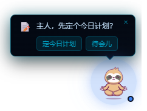
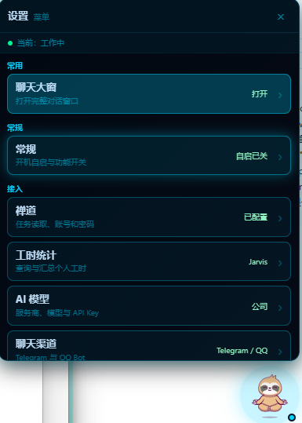
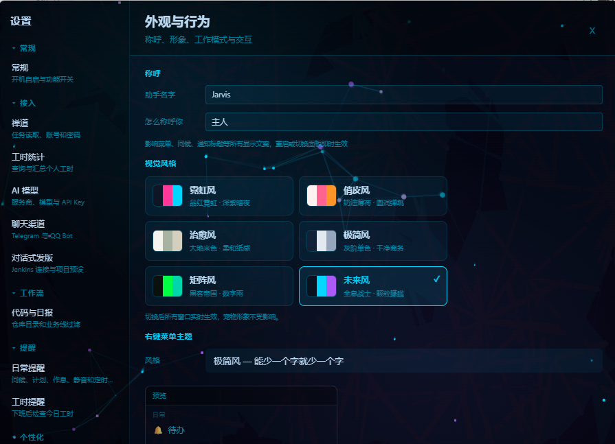

<div align="center">

# 🐾 Jarvis 桌宠助手

### 会干活儿的桌面 AI 宠物 · The AI Desktop Pet That Does Real Work

一只待在桌面角落、会自己溜达的小宠物，顺手把打工人的琐事干完：禅道任务提醒、工时自动填写、LLM 对话 Agent、插件系统——本地优先，数据不出你的电脑。

[](https://github.com/ynnyh/jarvis/releases/latest)
[](LICENSE)
[](https://github.com/ynnyh/jarvis/releases/latest)
[](https://ynnyh.github.io/jarvis/)
[](https://github.com/ynnyh/jarvis/stargazers)

[下载安装](#-下载安装) · [在线文档](https://ynnyh.github.io/jarvis/) · [常见问题](#-faq) · [更新日志](CHANGELOG.md) · [反馈问题](https://github.com/ynnyh/jarvis/issues)

<p align="center">
  
</p>

<p align="center">
  
  &nbsp;&nbsp;
  
</p>

<p align="center">
  
</p>

**Windows** · **macOS** ｜ 免费开源（MIT）

</div>

---

> **English**: Jarvis is a local-first **AI desktop pet** for Windows & macOS — a cute companion living in your desktop corner that also does real work: ZenTao task reminders, automatic timesheet filling, LLM chat with a tool-calling agent, and a declarative plugin system. Built with **Tauri v2 (Rust) + Vue 3**. All data stays on your machine; secrets go into the OS keychain.

## 为什么是 Jarvis？

市面上的 AI 助手要么是个聊天框，要么是个像素摆件。Jarvis 想把两者合起来：**一只活的桌宠，真的能替你干活**。

- **🐾 是活物，不是贴图**——自己散步、站桩、睡觉，点了会 squish，摸头会冒心心，agent 干活时它跟着一起忙
- **🤖 真的能干活**——任务到期自动提醒、扫 git 提交归因到任务、一键把工时写回禅道
- **🧩 会长大**——声明式插件基座，一份 `plugin.json` 就能给它加新本领（定时提醒、主动搭话、调工具）
- **🔒 数据不出门**——配置、对话、记忆全在本机，密钥进操作系统钥匙链

## ✨ 功能一览

### 🐾 活体桌宠

- **漫游行为引擎**：在工作区散步、站桩、睡觉，拎起来有反应，四层打断优先级
- **活物感动效**：5 种状态动效 + Lottie 变速、点击 squish、长按摸头心心 + 台词、随机 idle 小动作
- **AI 实况联动**：agent 思考中 / 干活中 / 开心，小人的状态同步变化
- **自由形象**：Lottie / 图片 / GIF / 宠物包 v2（多动作片段 gif / webm / spritesheet，右键点播「来一个 ▶」），大小 48–176px 自由缩放
- 贴边收纳、全屏可达拖拽、混合 DPI 多屏适配

### 🤖 AI 附身 + 对话 Agent

- **贴身迷你对话**：右键「对话」直接和小人聊，流式输出 + 工具执行状态行
- **会说话的提醒**：提醒文案由 LLM 按上下文现场生成，不是干巴巴的定时弹窗；可开主动搭话
- **Agent 工具调用**：对话式触发禅道操作、Jenkins 发版等真实动作
- **任意大模型**：OpenAI 兼容接口（DeepSeek / Moonshot / Qwen）+ Responses / Anthropic 协议
- **长期记忆**：sqlite-vec 向量检索

### 🧩 插件基座

- **声明式插件**：一份 `plugin.json` 定义「cron / 时间窗 / 事件触发 × 气泡 / LLM / 系统通知 / 消息渠道 / 工具动作」
- 用户插件目录即放即用，设置页可视化管理；喝水提醒示例开箱即试（参考 [内置时段问候插件](src-tauri/src/builtin_plugins/greetings.json)）

### 📋 任务与工时

- **禅道任务**：查询、到期 / 逾期提醒、风险分析
- **Git 归因**：扫描本地 git 提交自动关联任务，按代码量反推工时
- **一键写工时**：解析帆软 BI 工时明细按本人汇总，AI 精简描述后写回禅道

### 💬 多渠道消息

- Telegram / QQ Bot 收发消息（白名单 + 主动通知），人不在电脑前也能遥控

### 🔒 本地优先

- 所有数据在本机 `~/.jarvis/`（配置、对话、记忆、日志），除你自己配的禅道 / 帆软 / LLM 服务外不向任何服务器上传
- 密钥一律进操作系统钥匙链（Windows Credential Manager / macOS Keychain），明文配置里只留占位符
- 不配 LLM 也能用任务 / 工时 / 提醒；自动更新开箱即用

## 📥 下载安装

从 [GitHub Releases](https://github.com/ynnyh/jarvis/releases) 下载对应平台的安装包（[国内用户走 Gitee 镜像](https://gitee.com/ynnyh/jarvis/releases)更快）：

| 平台 | 安装包 | 安装方式 |
|---|---|---|
| Windows | `.exe`（NSIS） | 双击安装 |
| macOS | `.dmg`（Universal） | 拖入 Applications |

> macOS 未签名应用首次打开会被 Gatekeeper 拦截，运行安装脚本自动处理：
>
> ```bash
> curl -fsSL https://gitee.com/ynnyh/jarvis/releases/latest/download/install-macos-dev.sh | bash
> ```

## 🚀 首次配置（3 步）

启动后，配置不完整时会自动弹出**欢迎引导**，依次填：

1. **禅道地址 + 账号**（如 `http://zentao.example.com/zentao`）——密码存进 OS 钥匙链
2. **代码目录**——用于扫描 git 提交、归因任务
3. **LLM**（可选）——服务商 / 模型 / API Key，开启对话与 agent 能力

配置随时可在「设置」里改；`~/.jarvis/config.json` 是明文 JSON，可直接手动编辑。

## ❓ FAQ

- **我的数据存在哪？** 全部在本机 `~/.jarvis/`（配置、对话、记忆、日志）。除你自己配的禅道 / 帆软 / LLM 服务，不向任何服务器上传。
- **密钥安全吗？** API Key、密码、Token 一律存操作系统钥匙链（Windows Credential Manager / macOS Keychain），明文配置里只留占位符。
- **支持哪些大模型？** 任何 OpenAI 兼容接口：DeepSeek（默认）、Moonshot、Qwen，以及 Responses / Anthropic 协议。
- **必须联网吗？** 任务数据连你自己的禅道服务器；LLM 对话连你配的服务商。不配 LLM 也能用任务/工时/提醒功能。
- **数据隐私细节？** 见 [PRIVACY.md](PRIVACY.md)。

## 🛠️ 本地开发

```bash
npm ci
npm run desktop:dev        # 开发模式（端口 15174）
cargo test  --manifest-path src-tauri/Cargo.toml --lib
cargo clippy --manifest-path src-tauri/Cargo.toml --all-targets
```

- 构建 / 打包 / 发版：[BUILD.md](BUILD.md)
- 代码规范 / PR 流程：[CONTRIBUTING.md](CONTRIBUTING.md)

<details>
<summary><b>项目结构</b></summary>

```
src-tauri/                  # Rust 后端（Tauri 插件 + 业务逻辑）
├── src/
│   ├── lib.rs              # 入口：插件注册 + 窗口/托盘 + 命令注册
│   ├── commands/           # Tauri 命令（前端调用入口，按域分文件）
│   ├── plugins.rs          # 声明式插件宿主（cron / 时间窗 / 事件触发）
│   ├── chat_agent.rs       # LLM agent 循环 + 工具调度
│   ├── llm/                # LLM 客户端（chat / responses / anthropic 三协议）
│   ├── tools/              # 工具定义（禅道 / 帆软 / Git / 发版等）
│   ├── channels/           # Telegram / QQ 消息通道
│   ├── fine_report/        # 帆软 BI 工时解析
│   ├── git_scan/           # git 提交扫描 + 归因
│   ├── memory/             # 记忆系统（sqlite-vec 向量检索）
│   ├── zentao.rs           # 禅道 API 客户端
│   └── settings.rs         # 配置 + 钥匙链
desktop/                    # Vue 3 前端
├── src/
│   ├── App.vue             # 主窗口（桌宠 + 气泡 + 菜单）
│   ├── components/         # UI 组件 + 各子窗口（含桌宠对话、插件管理）
│   ├── composables/        # 组合式函数（漫游 / 插件宿主 / 提醒 / 拖拽等）
│   └── stores/             # 状态管理
scripts/                    # CI / 构建 / 发布脚本
docs/                       # VitePress 文档站
```

</details>

## ⭐ 支持一下

如果 Jarvis 有帮到你，欢迎点个 **Star** ⭐ —— 这是对独立开发者最实在的鼓励，也能让更多打工人看到它。想法和 bug 都欢迎提 [Issue](https://github.com/ynnyh/jarvis/issues)。

## License

[MIT](LICENSE) © ynnyh

### 第三方素材许可

- **「大肥鱼」内置宠物包**：DeepSeek 的社区二创形象（非官方）——原案 [@上善无形](https://space.bilibili.com/4456176)，DeepSeek 女仆鲸鱼娘设计 [@ZipZipPipe](https://space.bilibili.com/4168597)，形象采用 [CC BY-NC-SA 4.0](https://creativecommons.org/licenses/by-nc-sa/4.0/deed.zh-hans)；动画素材取自开源项目 [dsh-pet](https://github.com/PC2005-cloud/dsh-pet)（素材允许开源使用、禁止商用）。本应用以同口径（署名 · 非商业 · 相同方式共享）随应用分发该素材子集，**禁止用于商业用途**；素材仅做子集挑选与格式直迁，未修改内容。
